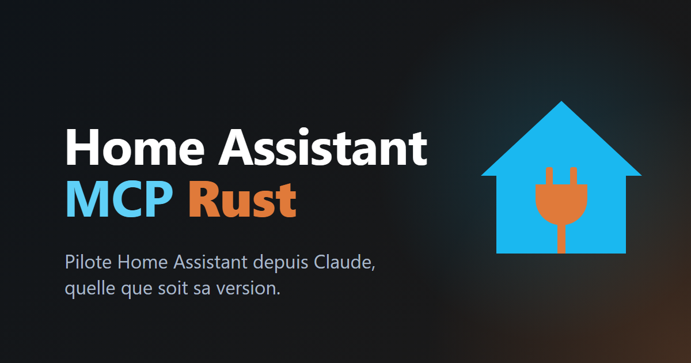

<p align="center">
  
</p>

<h1 align="center">Home Assistant MCP Rust</h1>

<p align="center">
  <a href="#français"></a>
  <a href="#english"></a>
</p>

## Français

Un serveur [MCP](https://modelcontextprotocol.io) pour Home Assistant, en Rust. C'est un seul binaire statique,
`ha-mcp` (environ 5 Mo, sans runtime), et l'image Docker est construite `FROM scratch`. Il marche avec toute version
récente de Home Assistant et avec [Home Assistant Rust](https://github.com/TojiiSamaa/Home-Assistant-Rust) (Home Assistant réécrit en
Rust), parce qu'il découvre tout à l'exécution :
- **Un outil par service**, nommé `domaine__service` (par exemple `light__turn_on` ou `shopping_list__add_item`).
  Chacun est construit à partir de la description du service : champs, sélecteurs convertis en JSON Schema, champs
  requis, `target` et `return_response`.
- **Les capacités sont détectées en les essayant**, jamais en comparant des versions. Si une commande répond
  `unknown_command` (ou une route 404), les outils qui en dépendent sont retirés, et `lister_outils` dit lesquelles
  manquent.
- **La liste des outils se met à jour en direct.** Le serveur écoute `service_registered`, `service_removed` et
  `component_loaded`, relit la liste des services toutes les 30 s par sécurité, et se reconnecte quand le lien tombe.
  Chaque changement est annoncé aux clients par `notifications/tools/list_changed`. Ajoute une intégration : ses
  services arrivent comme outils quelques secondes après.

### Outils

Les outils génériques sont toujours là, sauf si le serveur n'a pas la capacité dont ils dépendent ou si
`--lecture-seule` retire l'outil.

| Besoin | Outils |
|---|---|
| Entités et services | `etats`, `services`, `appeler_service` (n'importe quel service, toujours présent), `template` |
| Historique | `historique`, `journal` |
| Registres et liens | `registres` (entités, appareils, pièces, étages, étiquettes), `recherche_liee` |
| Intégrations (assistants) | `integrations`, `flux_demarrer`, `flux_etape`, `flux_annuler` |
| Tableaux de bord et barre latérale | `tableaux_lister`, `tableau_lire`, `tableau_enregistrer`, `page_creer`, `page_modifier`, `page_supprimer`, `barre_regler` |
| Automatisations, scripts, scènes | `automatisme_lire`, `automatisme_ecrire`, `automatisme_supprimer` |
| Presets (pages, thème, barre) | `presets_lister`, `preset_appliquer`, `preset_annuler`, `preset_exporter` |
| Tout le reste | `ws` (n'importe quelle commande WebSocket), `rest` (n'importe quelle route sous `/api/`) |
| Auto-description | `lister_outils` (tous les outils de l'instance, en markdown) |

La [skill](skill/home-assistant-mcp-rust/SKILL.md) documente les paramètres de chaque outil générique, dans une
section générée depuis le code et vérifiée par un test.
[skill/home-assistant-mcp-rust/reference/exemple-outils.md](skill/home-assistant-mcp-rust/reference/exemple-outils.md)
est la vraie sortie de `ha-mcp lister` sur un Home Assistant neuf.

**Les presets** s'appliquent côté client avec les commandes standard : ils créent des pages de tableau de bord,
règlent le thème et la barre latérale. Ce qu'ils remplacent est d'abord sauvegardé (données frontend de l'utilisateur
du jeton, les 10 dernières), donc `preset_annuler` le remet. Trois presets sont embarqués ; `--presets DOSSIER` ajoute
tes fichiers JSON, et `preset_exporter` fait un preset de la configuration actuelle.

### Installation

**Binaire** : télécharge `ha-mcp-linux-amd64`, `ha-mcp-linux-arm64` ou `ha-mcp-windows-amd64.exe` depuis les
[publications](https://github.com/TojiiSamaa/Home-Assistant-MCP-Rust/releases) (sommes de contrôle dans
`SHA256SUMS`), renomme-le `ha-mcp` et mets-le dans ton `PATH`. Les versions Linux sont statiques (musl) et tournent
sur toute distribution.

**Docker** : `ghcr.io/tojiisamaa/home-assistant-mcp-rust` (linux/amd64 et linux/arm64). L'image tourne sous un
utilisateur sans droits et écoute sur `0.0.0.0:8765` en mode `http`.

**Depuis les sources** : `cargo build --release` (Rust 1.88 ou plus), puis `target/release/ha-mcp`.

Il faut un **jeton d'accès longue durée** de Home Assistant : dans Home Assistant, va dans ton profil, puis Sécurité,
puis « Jetons d'accès longue durée ». Certains outils demandent un utilisateur administrateur (registres, tableaux de
bord, assistants d'intégration, automatisations).

### Configuration

| Option | Variable | Défaut | Rôle |
|---|---|---|---|
| `--url URL` | `HA_URL` | `http://127.0.0.1:8123` | adresse de Home Assistant (`http` ou `https`) |
| `--jeton-fichier FICHIER` | `HA_TOKEN_FILE` |  | fichier du jeton ; ou le jeton lui-même dans `HA_TOKEN` |
| `--lecture-seule` | `HA_MCP_LECTURE_SEULE=1` | non | lecture seule : aucun outil qui écrit, `ws` limité aux commandes de lecture, `rest` au GET |
| `--domaines a,b` | `HA_MCP_DOMAINES` | tous | outils de service de ces domaines seulement |
| `--sans-domaines a,b` | `HA_MCP_SANS_DOMAINES` |  | pas d'outils de service pour ces domaines |
| `--max-services N` | `HA_MCP_MAX_SERVICES` | illimité | au plus N outils de service (`0` = aucun ; `appeler_service` reste) |
| `--presets DOSSIER` | `HA_MCP_PRESETS` |  | presets en plus (`*.json`), et là où `preset_exporter` écrit |
| `--ecoute ADRESSE:PORT` | `HA_MCP_ECOUTE` | `127.0.0.1:8765` | mode `http` : adresse d'écoute |
| `--jeton-serveur-fichier FICHIER` | `HA_MCP_JETON_FICHIER` |  | mode `http` : fichier du jeton Bearer que les clients envoient ; ou `HA_MCP_JETON` |

Modes : `ha-mcp` ou `ha-mcp stdio` (défaut), `ha-mcp http`, `ha-mcp lister` (écrit la liste des outils en markdown
puis sort). `ha-mcp --help` liste tout.

Les jetons ne sont jamais journalisés ni renvoyés. Préfère les formes `*_FILE` à un jeton sur la ligne de commande.

### Avec Claude Code

stdio (Claude Code lance le serveur) :

```sh
claude mcp add ha -e HA_URL=http://homeassistant.local:8123 -e HA_TOKEN_FILE=$HOME/.config/ha-mcp/token -- ha-mcp
```

HTTP (un serveur partagé par plusieurs clients, ici avec Docker) :

```sh
docker run -d --name ha-mcp -p 127.0.0.1:8765:8765 \
  -e HA_URL=http://homeassistant.local:8123 -e HA_TOKEN -e HA_MCP_JETON \
  ghcr.io/tojiisamaa/home-assistant-mcp-rust http
claude mcp add --transport http ha http://127.0.0.1:8765/mcp --header "Authorization: Bearer $HA_MCP_JETON"
```

### Avec Claude Desktop

Dans `claude_desktop_config.json` :

```json
{
  "mcpServers": {
    "ha": {
      "command": "ha-mcp",
      "env": { "HA_URL": "http://homeassistant.local:8123", "HA_TOKEN_FILE": "/chemin/du/jeton" }
    }
  }
}
```

Avec Docker plutôt que le binaire : `"command": "docker"` et `"args": ["run", "-i", "--rm", "-e", "HA_URL", "-e",
"HA_TOKEN", "ghcr.io/tojiisamaa/home-assistant-mcp-rust"]`, avec `HA_URL` et `HA_TOKEN` dans `env`.

### Installer la skill

La skill apprend au modèle quel outil prendre pour quel besoin, avec des recettes et des pièges. Copie le dossier dans
tes skills :

```sh
cp -r skill/home-assistant-mcp-rust ~/.claude/skills/
```

Sous Windows : `Copy-Item -Recurse skill\home-assistant-mcp-rust $HOME\.claude\skills\`.

### Exemples

Ce que tu peux demander une fois le serveur branché :
- « Allume la lumière du salon à 50 % » → `light__turn_on {target: {entity_id: "light.salon"}, brightness_pct: 50}`
- « Ajoute une liste de courses » → `flux_demarrer {handler: "shopping_list"}`, puis `flux_etape`, puis le nouvel
  outil `shopping_list__add_item` apparaît.
- « Fais un tableau de bord tablette pour la cuisine » → `page_creer {url_path: "cuisine-tablette", title: "Cuisine", config: {views: [...]}}`
- « Qu'est-ce qui s'est passé avec la porte d'entrée aujourd'hui ? » → `journal {entity_id: "binary_sensor.porte_entree"}`
- « Qu'est-ce qui utilise cet appareil ? » → `recherche_liee {item_type: "device", item_id: "..."}`

### Transports et sécurité

- **stdio** : un message JSON par ligne ; les requêtes s'exécutent en parallèle.
- **Streamable HTTP** sur `/mcp` (POST, GET pour le flux de notifications, DELETE pour fermer une session). La
  session (`Mcp-Session-Id`) est créée à `initialize` et reste facultative. L'ancien transport SSE est sur `/sse` et
  `/messages/{id}`. `/sante` répond `ok` sans jeton, pour les sondes.
- **Contrôles** : un jeton Bearer est obligatoire (comparé en temps constant). Un `Origin` étranger reçoit 403
  (protection contre le DNS rebinding). Après `initialize`, `MCP-Protocol-Version` doit être 2025-11-25, 2025-06-18,
  2025-03-26 ou 2024-11-05.
- **Réponses** : coupées à 100 000 octets. Chaque outil porte `readOnlyHint`.
- **Exposition** : garde le serveur HTTP sur localhost ou derrière un mandataire TLS ; il détient un jeton
  administrateur de ta maison.

### Tests

- `cargo test` lance les tests unitaires et les tests du protocole contre un faux Home Assistant (REST et WebSocket
  sur un seul port). Un test vérifie que la section générée de la skill correspond au code ;
  `MAJ_SKILL=1 cargo test skill_a_jour` la réécrit.
- `python3 -I tests/reel/test_reel.py stable 2025.6 2024.6 maison` lance de vrais conteneurs (`hamcp-test-*`,
  retirés à la fin) après `docker build -t hamcp-test-mcp:local .`. Pour chaque cible : onboarding, jeton longue durée
  créé par `ws`, liste des outils, `input_boolean__toggle`, un modèle, une page de tableau de bord, une intégration
  ajoutée sans matériel (liste de courses) et le `list_changed` qui suit, un script créé (un service `script.<id>`
  nouveau, son `list_changed` et son outil généré), puis le mode lecture seule. `nom=IMAGE` ajoute une cible tirée
  d'une autre image.

### Licence

[Apache-2.0](LICENSE). Voir [NOTICE](NOTICE).

---

## English

An [MCP](https://modelcontextprotocol.io) server for Home Assistant, in Rust. It is a single static binary, `ha-mcp`
(about 5 MB, no runtime), and the Docker image is built `FROM scratch`. It works with any recent Home Assistant version
and with [Home Assistant Rust](https://github.com/TojiiSamaa/Home-Assistant-Rust) (Home Assistant rewritten in Rust), because it
discovers everything at runtime:
- **One tool per service**, named `domain__service` (for example `light__turn_on` or `shopping_list__add_item`). Each
  one is built from the service's own description: fields, selectors converted to JSON Schema, required fields,
  `target` and `return_response`.
- **Capabilities are detected by trying them**, never by comparing versions. If a command answers `unknown_command`
  (or a route answers 404), the tools that depend on it are removed, and `lister_outils` says which commands are missing.
- **The tool list updates live.** The server listens to `service_registered`, `service_removed` and
  `component_loaded`, re-reads the service list every 30 s as a fallback, and reconnects when the link drops. Each
  change is announced to clients with `notifications/tools/list_changed`. Add an integration and its services show up
  as tools a few seconds later.

Tool names, descriptions and messages are in French, like the project it comes from. The model understands them, and
the included skill explains them.

### Tools

The generic tools are always there, unless the server lacks the capability they depend on or the tool is removed by
`--lecture-seule`.

| Need | Tools |
|---|---|
| Entities and services | `etats`, `services`, `appeler_service` (any service, always present), `template` |
| History | `historique`, `journal` |
| Registries and links | `registres` (entities, devices, areas, floors, labels), `recherche_liee` |
| Integrations (config flows) | `integrations`, `flux_demarrer`, `flux_etape`, `flux_annuler` |
| Dashboards and sidebar | `tableaux_lister`, `tableau_lire`, `tableau_enregistrer`, `page_creer`, `page_modifier`, `page_supprimer`, `barre_regler` |
| Automations, scripts, scenes | `automatisme_lire`, `automatisme_ecrire`, `automatisme_supprimer` |
| Presets (dashboards, theme, sidebar) | `presets_lister`, `preset_appliquer`, `preset_annuler`, `preset_exporter` |
| Anything else | `ws` (any WebSocket command), `rest` (any route under `/api/`) |
| Self-description | `lister_outils` (every tool of this instance, as markdown) |

The [skill](skill/home-assistant-mcp-rust/SKILL.md) documents each generic tool's parameters, in a section generated
from the code and checked by a test.
[skill/home-assistant-mcp-rust/reference/exemple-outils.md](skill/home-assistant-mcp-rust/reference/exemple-outils.md)
is the real output of `ha-mcp lister` on a fresh Home Assistant.

**Presets** are applied client-side with standard commands: they create dashboard pages, set the theme and the sidebar.
Whatever they replace is saved first (the token user's frontend data, last 10), so `preset_annuler` restores it. Three
presets are embedded; `--presets DIR` adds your own JSON files, and `preset_exporter` turns the current configuration
into one.

### Install

**Binary**: download `ha-mcp-linux-amd64`, `ha-mcp-linux-arm64` or `ha-mcp-windows-amd64.exe` from the
[releases](https://github.com/TojiiSamaa/Home-Assistant-MCP-Rust/releases) (checksums in `SHA256SUMS`), rename it
`ha-mcp` and put it on your `PATH`. The Linux builds are static (musl) and run on any distribution.

**Docker**: `ghcr.io/tojiisamaa/home-assistant-mcp-rust` (linux/amd64 and linux/arm64). It runs as an unprivileged
user and listens on `0.0.0.0:8765` in `http` mode.

**From source**: `cargo build --release` (Rust 1.88 or later), then use `target/release/ha-mcp`.

You need a Home Assistant **long-lived access token**: in Home Assistant, go to your profile, then Security, then
"Long-lived access tokens". Some tools need an admin user (registries, dashboards, config flows, automations).

### Configuration

| Option | Variable | Default | Meaning |
|---|---|---|---|
| `--url URL` | `HA_URL` | `http://127.0.0.1:8123` | Home Assistant address (`http` or `https`) |
| `--jeton-fichier FILE` | `HA_TOKEN_FILE` |  | file holding the token; or the token itself in `HA_TOKEN` |
| `--lecture-seule` | `HA_MCP_LECTURE_SEULE=1` | off | read-only: no tool that writes, `ws` limited to read commands, `rest` to GET |
| `--domaines a,b` | `HA_MCP_DOMAINES` | all | service tools for these domains only |
| `--sans-domaines a,b` | `HA_MCP_SANS_DOMAINES` |  | no service tools for these domains |
| `--max-services N` | `HA_MCP_MAX_SERVICES` | unlimited | at most N service tools (`0` = none; `appeler_service` stays) |
| `--presets DIR` | `HA_MCP_PRESETS` |  | extra presets (`*.json`), and where `preset_exporter` writes |
| `--ecoute ADDR:PORT` | `HA_MCP_ECOUTE` | `127.0.0.1:8765` | `http` mode: listening address |
| `--jeton-serveur-fichier FILE` | `HA_MCP_JETON_FICHIER` |  | `http` mode: file holding the Bearer token clients must send; or `HA_MCP_JETON` |

Modes: `ha-mcp` or `ha-mcp stdio` (default), `ha-mcp http`, `ha-mcp lister` (prints the tool list as markdown and
exits). `ha-mcp --help` lists everything.

Tokens are never logged or echoed. Prefer the `*_FILE` forms over putting a token on a command line.

### Use with Claude Code

stdio (Claude Code starts the server):

```sh
claude mcp add ha -e HA_URL=http://homeassistant.local:8123 -e HA_TOKEN_FILE=$HOME/.config/ha-mcp/token -- ha-mcp
```

HTTP (one server shared by several clients, here with Docker):

```sh
docker run -d --name ha-mcp -p 127.0.0.1:8765:8765 \
  -e HA_URL=http://homeassistant.local:8123 -e HA_TOKEN -e HA_MCP_JETON \
  ghcr.io/tojiisamaa/home-assistant-mcp-rust http
claude mcp add --transport http ha http://127.0.0.1:8765/mcp --header "Authorization: Bearer $HA_MCP_JETON"
```

### Use with Claude Desktop

In `claude_desktop_config.json`:

```json
{
  "mcpServers": {
    "ha": {
      "command": "ha-mcp",
      "env": { "HA_URL": "http://homeassistant.local:8123", "HA_TOKEN_FILE": "/path/to/token" }
    }
  }
}
```

With Docker instead of the binary: `"command": "docker"` and `"args": ["run", "-i", "--rm", "-e", "HA_URL", "-e",
"HA_TOKEN", "ghcr.io/tojiisamaa/home-assistant-mcp-rust"]`, with `HA_URL` and `HA_TOKEN` in `env`.

### Install the skill

The skill teaches the model which tool fits which need, with recipes and pitfalls. Copy the folder into your skills:

```sh
cp -r skill/home-assistant-mcp-rust ~/.claude/skills/
```

On Windows: `Copy-Item -Recurse skill\home-assistant-mcp-rust $HOME\.claude\skills\`.

### Examples

Things you can ask once the server is connected:
- "Turn on the living room light at 50 %" → `light__turn_on {target: {entity_id: "light.salon"}, brightness_pct: 50}`
- "Add a shopping list" → `flux_demarrer {handler: "shopping_list"}`, then `flux_etape`, then the new
  `shopping_list__add_item` tool appears.
- "Make a tablet dashboard for the kitchen" → `page_creer {url_path: "kitchen-tablet", title: "Kitchen", config: {views: [...]}}`
- "What happened to the front door today?" → `journal {entity_id: "binary_sensor.front_door"}`
- "What uses this device?" → `recherche_liee {item_type: "device", item_id: "..."}`

### Transports and security

- **stdio**: one JSON message per line; requests run in parallel.
- **Streamable HTTP** on `/mcp` (POST, GET for the notification stream, DELETE to end a session). The session
  (`Mcp-Session-Id`) is created at `initialize` and is optional. The legacy SSE transport is on `/sse` plus
  `/messages/{id}`. `/sante` answers `ok` without a token, for health checks.
- **Checks**: a Bearer token is required (compared in constant time). A foreign `Origin` gets 403 (DNS rebinding
  protection). After `initialize`, `MCP-Protocol-Version` must be one of 2025-11-25, 2025-06-18, 2025-03-26 or
  2024-11-05.
- **Output**: responses are cut at 100 000 bytes. Each tool carries `readOnlyHint`.
- **Exposure**: keep the HTTP server on localhost or behind a TLS reverse proxy; it holds an admin token for your home.

### Tests

- `cargo test` runs the unit tests and the protocol tests against a fake Home Assistant (REST and WebSocket on one
  port). One test checks that the skill's generated section matches the code; `MAJ_SKILL=1 cargo test skill_a_jour`
  rewrites it.
- `python3 -I tests/reel/test_reel.py stable 2025.6 2024.6 maison` runs real containers (`hamcp-test-*`, removed at the
  end) after `docker build -t hamcp-test-mcp:local .`. For each target it covers onboarding, a long-lived token
  created through `ws`, the tool list, `input_boolean__toggle`, a template, a dashboard page, an integration added
  without hardware (shopping list) and the matching `list_changed`, a new script (a new `script.<id>` service, its
`list_changed` and its generated tool), then read-only mode. `name=IMAGE` adds a target from another image.

### License

[Apache-2.0](LICENSE). See [NOTICE](NOTICE).
