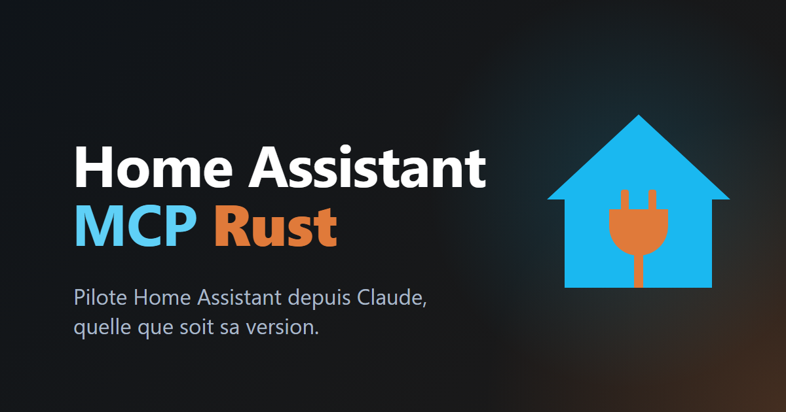

Home Assistant MCP Rust est un serveur MCP écrit en Rust qui laisse Claude (ou tout client MCP) piloter Home Assistant : un seul binaire statique d'environ 5 Mo pour Linux et Windows, ou une image Docker.
Il découvre tout en direct, quelle que soit la version de Home Assistant : un outil par service, construit depuis la description du service, et une intégration ajoutée apporte ses outils quelques secondes plus tard.
Il marche aussi avec Home Assistant Rust, et inclut une skill complète qui liste chaque outil, des presets de tableaux de bord et un mode lecture seule.
Projet sous licence Apache-2.0.
